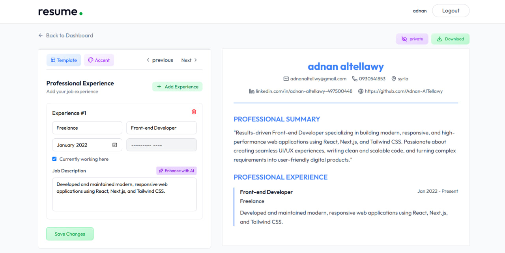
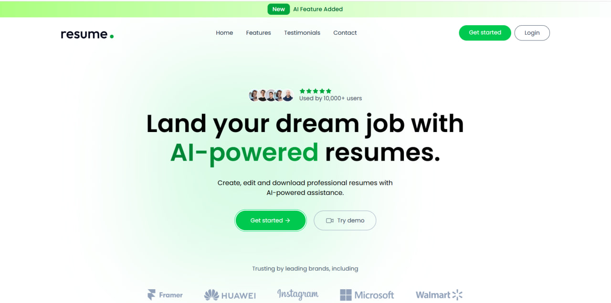

# Resume Builder

A web app for creating a professional resume in minutes, with live preview and multiple templates.

Live demo: https://resume-builder-24.netlify.app

## Screenshots

## Features

- Live preview that updates while you type
- Multiple resume templates to choose from
- Download the finished resume as a PDF
- User data is saved between sessions

## Tech Stack

- [React](https://react.dev/)
- Deployed on [Netlify](https://www.netlify.com/)

## Getting Started

git clone https://github.com/Adnan-AlTellawy/resume-builder.git
cd resume-builder
npm install
npm run dev
Then open the local address shown in your terminal.

## Author

Adnan Jahed Al-Tellawy — Front-End Developer
[GitHub](https://github.com/Adnan-AlTellawy) · [LinkedIn](https://www.linkedin.com/in/adnan-altellawy-497500448) · [Portfolio](https://adnan-altellawy.netlify.app) · adnanaltellawy@gmail.com